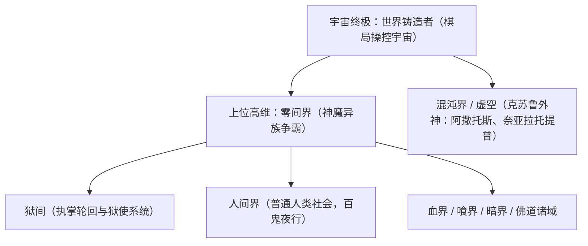

# 原著世界观与设定解析

《吃鬼的男孩》是“恐怖的阿肥”（穿黄衣的阿肥）的成名处女作，全书构建了一套融合了**民间中式志怪、地狱职阶系统、肉身吞噬进化、克苏鲁神话体系与高维宇宙位面**的庞大世界观。

---

## 一、 核心概念：鬼物与变异机制

1. **诞生原理**：
   * 人类死后本应顺应法则前往“狱间”投胎轮回。
   * 但如果死前心中怀有极度的负面情绪（极怨、极怒、贪婪、死不瞑目），其灵魂将发生异化扭曲，无法被狱间法则牵引，从而滞留人世间，化为凶鬼、恶鬼，以汲取人类的恐惧和生机为食。
2. **鬼物危险品阶**：
   * **普通鬼物 / 初级鬼物**：多为游魂执念，刚成形，依靠微弱幻象或环境降温害人（如水鬼、残肢鬼）。
   * **中级鬼物**：具备实体化杀伤力、拥有简单的怨念领域或物理破坏手段（如浸水婴儿鬼）。
   * **高级鬼物**：诞生灵智，能够大规模操纵活人，凝聚出本命咒印（如红指甲女鬼）。
   * **真鬼（魇）**：超越常理的存在，拥有独立的能力规则和魇石/核心，极难被物理消灭。
   * **鬼王 / 上位大凶**：可开辟独立鬼蜮，拥有逆乱一方天地的伟力（如东瀛酒吞童子、万罪深渊魔王等）。

---

## 二、 守护秩序者：狱使系统

1. **诞生与契约**：
   * “狱间”（地狱高层意识）会在人间濒死但意志异常坚定的人类中，挑选代行者。
   * 给予其一颗**“主魂石”**。主魂石直接嵌入或取代宿主的心脏，与宿主灵魂深度交融，赋予其调动狱间规则的超凡之力。
2. **晋升阶位与特权**：
   * **狱卒**：初入行的新人，主魂石刚激活，体魄超越常人，掌握基础的鬼气感知与初级能力。
   * **狱目**：经过考核转正的骨干，拥有独特的本命战斗能力（控火、御木、结界、肉身硬化等），负责一个片区的安宁。
   * **狱司**：一省或大区域的领头强者，具备开辟小型领域能力，掌握高阶法则。
   * **狱尉**：狱使高层砥柱，可跨越位面执行特殊巡查与肃清任务，战力威压一方。
   * **狱督 / 狱皇**：狱使顶尖掌舵人，直接与狱间本源沟通。

---

## 三、 主角张陈的终极外挂：“喰道”（饕餮体质）

张陈并非通过常规方式成为狱使，而是因在金溪县金水桥跳水救人，被上一代神秘强者将体内的黑色奇珠换入心脏，从而踏上了诸天唯一的**“喰鬼/噬灵”**之道。

1. **生理异变（口器吞噬）**：
   * 张陈身体的右手掌心、脖颈、乃至后来的周身毛孔，皆能撕裂生出布满上古利齿的“喰口”。
   * **以鬼为食**：普通的物理或法术攻击只能打散鬼气，而张陈的嘴口可以直接**活嚼、生吞**鬼物及一切负面能量。
2. **消化与进化反馈**：
   * **免除反噬**：喰道能够彻底净化并提纯鬼物的怨念与精魄，化作无属性的本源神髓。
   * **肉身淬炼**：吞噬越多，张陈的骨骼、经络、肌体强度成几何倍提升，最终达到“肉身成圣”。
   * **掠夺神通**：吞食具备特殊能力的鬼物，可同化其核心能力（如吞食空间鬼掌握虚空瞬移与储物、吞食血鬼掌握血能分身）。
3. **终极神装与神通**：
   * **本源喰齿（81颗）**：张陈体内最根本的喰道杀器，无坚不摧。
   * **吞龙臂**：在上位世界与旧日支配者克苏鲁合作，斩杀万丈烛龙，熔炼烛龙脊髓与81颗本源喰齿锻造而成的终极神器臂膀。
   * **体内世界**：在喰腹中孕育出一个真正拥有独立生态与法则的宇宙雏形位面。

---

## 四、 宏观世界架构：多重位面阶梯

1. **人间界**：看似平静现代都市，实则暗流涌动。
2. **狱间**：转生与狱使管理机构。
3. **零间**：所有人间强者破空飞升的上位世界。
4. **混沌界/克苏鲁神系**：不可名状的高维混乱源泉，无面男（奈亚拉托提普）等视万界为玩物。
5. **世界铸造者**：宇宙最终幕后管理者，将亿万大世界当成棋子，主角最终超脱并被收纳为其中一员。
