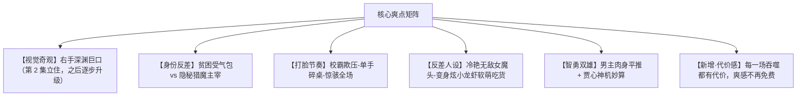

# 竖屏微短剧《掌中有深渊》总案策划与过审指南 · 2.0 版

> **2.0 版本说明**：本版针对 1.0「单集 45 秒、每集一次爽点闭环」造成的观感过载做了结构性重写。规格、节奏模型、能力阶梯、反派阶梯、付费卡点全部重排。
> 原著资料与合规改造方案沿用 1.0，不在本次修订范围。

---

## 一、 项目商业定位

* **暂定剧名**：《掌中有深渊》（备选：《我的右手能吞异兽》《深渊巡夜使》）
* **题材类型**：都市玄幻 / 悬疑惊悚 / 扮猪吃虎 / 极限打脸 / 异能觉醒
* **播放规格**：竖屏（9:16），共 **100 集**，**单集 60 ~ 75 秒**（均值约 68 秒），**全剧总时长约 113 分钟**
* **对标作品**：《开局觉醒神级异能》《寄生兽》《毒液》《咒术回战》
* **目标受众**：18-35 岁男性受众为主，兼顾喜爱二次元异能、暗黑爽感、惊悚打怪打脸的年轻网生代群体。

### 1.1 为什么 2.0 要改：1.0 的三处结构性过载

| 病灶 | 1.0 表现 | 后果 | 2.0 解法 |
| :--- | :--- | :--- | :--- |
| 总量与密度双杀 | 80 集 × 45 秒 = **60 分钟**；第 46-56 集 11 集塞 12 个转折 | 平均每集 1.1 个转折，产生"PPT 感"，观众记不住人物 | 100 集 × 60-75 秒 ≈ 113 分钟，密度减半，允许铺垫与余韵 |
| 能力通胀 | 第 10 集即解锁隔空念力（人物档案明定为"后期"能力） | 后期牌 3 集打光，成长曲线塌陷 | 能力阶梯整体后移，念力推迟至第 36 集 |
| 反派通胀 | 第 37 集已"名动天府市地下圈"，第 71 集才突然冒出暗界议会天王 | 每集换更大反派垫背，主角压迫感反而递减 | 改为**递进阶梯**：暗界议会第 45 集露头，第 88 集才总爆发 |
| 钩子贬值 | 80 集中 **76 集**以"卡点"收尾 | 钩子通胀，付费卡点与普通卡点无差异 | 钩子分三级（强/软/留白），仅 5 个付费强钩 |

---

## 二、 2.0 节奏模型：四拍循环 + 双集叙事单元

1.0 的"5-15-20-5"要求每一集都走完「奇观 → 压迫 → 反杀 → 卡点」的完整闭环，76 集如此，必然疲劳。2.0 把这个闭环从**单集**下移到**叙事单元**。

### 2.1 四拍循环（每集内部结构）

| 拍位 | 时长 | 功能 | 强度 | 判定标准 |
| :--- | :--- | :--- | :--- | :--- |
| **呼吸拍** | 10-20 秒 | 建立人物状态、推进关系、交付信息增量 | ★ | 无攻击性事件，但观众离开时知道的事比进来时多 |
| **升级拍** | 15-25 秒 | 压迫累积、威胁具体化、敌人从抽象变具体 | ★★ | 主角处于受限或下风，敌方意图首次可被观众理解 |
| **释放拍** | 15-25 秒 | 反杀、揭示、爽点兑现、力量差逆转 | ★★★★★ | 主角占据上风，前面积压的憋屈在此刻一次性兑现 |
| **余韵拍** | 8-15 秒 | 代价、后果、关系沉淀、下一条线埋设 | ★ | 事情已经发生，情绪落地，观众有空间消化 |

**硬性规则**：

* **禁止连续两集都是释放拍** —— 这是 1.0 的病根，2.0 不允许。
* **呼吸拍不许是废话**。它是低强度，但必须携带信息或关系变化。判断标准：删掉这集，观众是否会少知道一件重要的事？如果不会，这集就白写了。
* **余韵拍必须留痕**。打完怪不是结束，要让代价显形（张陈的暴食反噬、赵鹏的恐惧后遗症、贾心的试探）。

### 2.2 双集叙事单元

* **奇数集 = 呼吸拍 + 升级拍**，以悬念或压迫收尾（**软钩**）。
* **偶数集 = 释放拍 + 余韵拍**，以反转、代价或关系收尾（**强钩 / 留白钩**）。
* 篇首允许连续两个呼吸拍（铺陈用），篇末高潮允许连续两个释放拍（爽点叠打）。

### 2.3 强度曲线

* 每 **2 集**一个小释放点。
* 每 **6-8 集**一次中等高潮（篇章内小高潮）。
* 每 **20 集**一次篇章高潮（全剧 5 个）。
* 全剧 **4 个付费强钩** + 1 个终极付费强钩。

### 2.4 钩子分级

| 级别 | 用法 | 数量 | 示例 |
| :--- | :--- | :--- | :--- |
| **强钩** | 付费卡点、篇章高潮 | 5 个 | 第 18、40、60、78、92 集 |
| **软钩** | 悬念未解、威胁逼近 | 约 30 个 | 照片上滴血的五星血印、贾心的黑金请柬 |
| **留白钩** | 关系沉淀、情绪余韵 | 约 25 个 | 富江第一次叫"主人"、张陈在厨房盯着生肉发呆 |

---

## 三、 能力阶梯与反派强度重排

### 3.1 能力解锁时间线（2.0）

| 能力 | 1.0 解锁集 | 2.0 解锁集 | 延后理由 |
| :--- | :--- | :--- | :--- |
| 噬灵巨口（初成） | 第 2 集 | 第 2 集 | 核心设定，不动 |
| 体魄强化 | 第 3 集 | 第 3-4 集 | 与首次吞噬的代价同集落地 |
| 寒冰抗性 / 控水 | 第 14 集 | 第 18 集 | 呼应篇章一收尾 |
| 隔空念力 / 控物 | 第 10 集 ⚠️ | **第 36 集** | 1.0 提前 26 集透支后期能力 |
| 深渊祖龙虚影 | 第 18 集 | 第 80 集 | 与富江血光成甲同拍，视觉爆点合并 |
| 饕餮血脉完全体 | 第 61 集 | 第 94 集 | 留到终局邪神战 |
| 空间感知 / 气息锁定 | 第 36 集 | 第 84 集 | 替代 1.0 后期无铺垫的强度跃升 |

### 3.2 反派强度阶梯（2.0）

| 层级 | 敌人 | 2.0 出现集 | 铺垫集 |
| :--- | :--- | :--- | :--- |
| 杂兵层 | 校霸赵鹏一行、街头混混 | 第 6-12 集 | 第 5-8 集 |
| 一阶异化体 | 青皮水魅元素生物 | 第 4 集 | — |
| 二阶异化体 | 泥沼兽 | 第 14 集 | 第 13 集 |
| 三阶 | 韩明（血指甲宿主） | 第 28 集 | 第 21-27 集 |
| 区域势力 | 赵家（跨国集团 + 黑帮） | 第 39 集 | 第 35-38 集 |
| 三阶顶峰 | 罗丹伯爵（地脉熔炉） | 第 61 集 | 第 46 集起三次提及 |
| 官方组织 | 镇夜司 | 第 14 集 | 第 13 集 |
| 跨域组织 | **暗界议会** | 第 45 集（露头）→ 第 59 集（首次正面对抗）→ 第 92 集（总爆发） | 第 39-44 集 |
| 神话级 | 邪神虚影 | 第 91 集 | 第 85-90 集 |

> **关键改动**：1.0 中暗界议会在第 71 集凭空出现，2.0 让它从第 39 集起以"旁人对话里的一个名字"存在。
> 观众第 45 集第一次看见他们，第 59 集首次正面对抗，第 92 集才总爆发。反派体量靠**累积**建立，不靠突然甩出一张更大的牌。

---

## 四、 核心爆款逻辑与多重爽点设计

1. **第一视角的吸睛奇观**：原生家庭拮据、高三唯唯诺诺的张陈，右手掌心长出一张长满太古獠牙的大嘴，专吃夜幕下的魑魅魍魉。
2. **反套路英雄主义（以恶制恶）**：不讲虚伪的大道理，面对校园霸凌与反派直接物理超度，能动手绝不哔哔。
3. **高粘度情感羁绊**：对青梅竹马校花王艺芷的绝对偏爱；收服绝美女怪"富江"后令人捧腹又温馨的反差生活日常。
4. **2.0 新增：代价即深度**。1.0 的张陈吞噬越多越强、毫无负担；2.0 每一次吞噬都留下生理与心理痕迹，观众跟着他一起"变强但变坏"，这是爽感的第二层。

---

## 五、 审查红线规避与合规化改造（生死攸关）

短剧在抖音、快手、微信小程序及各大视频平台上线，需严格执行广电"网络微短剧备案审查"标准。以下为必须落地的"安全转换表"：

### 1. 名词系统合规替换

| 原始敏感词 | 合规改造名称 | 叙事底层设定解释 |
| :--- | :--- | :--- |
| **鬼物 / 恶鬼** | **异化体 / 执念体 / 暗渊噬生种** | 人类极端负面情绪与地脉游离暗能结合产生的**生物能量畸变**。 |
| **狱间 / 地狱** | **苍蓝结界 / 镜渊世界** | 存在于现实维度背面的平行镜像空间，负责调节地球生态平衡。 |
| **狱使** | **巡夜人 / 镇夜司专员** | 官方隐秘编制的超自然调查与安全保障组织，持证上岗。 |
| **主魂石** | **神核 / 暗能共鸣水晶** | 来自高纬度维度的能量载体，赋予人类驾驭特殊场域的能力。 |
| **生吃恶鬼** | **异能噬核 / 能量炼化** | 利用掌心特质直接吸收并纯化畸变能量，非吞食血肉。 |

### 2. 视觉呈现安全法则（严防封禁）

* **禁止血腥肉末**：手掌吞噬过程中，严禁出现撕裂肌肉、内脏、流血喷溅的镜头。
* **采用粒子光效替代**：掌心裂口开启时带有**暗紫金色魔焰与符文**；怪物被咬中后迅速化为**蓝黑色的光斑粒子、能量残烟**被卷入掌心。
* **怪物造型非人化**：原作中的"婴儿鬼"不可使用逼真婴儿尸首形象，应做成**具有青绿色鳞片的水魅元素生物**；强调尖耳、触须、魔纹、异瞳，削弱其"死人/尸体"的人形特征。

### 3. 2.0 新增合规条款（因节奏放缓而必须加严）

* **惊吓强度分级**：2.0 镜头时长变长，同一恐怖素材的压迫时间翻倍。儿童面部、血肉撕裂特写、慢镜头死亡过程一律禁用，恐怖点改用**声音先于画面**的手法。
* **幼态角色保护**：凡带有婴幼儿体态联想的异化体，一律不得保留明显人类幼儿特征，全年龄向平台版本统一替换为"水魅元素生物"。
* **暴力尺度**：1.0 的"一拳轰成血雾""踢飞吐血昏死"在 2.0 延长镜头后更易被判定为过度暴力，统一改为**击飞 / 击晕 / 击退**，避免出现血液飞溅画面。
* **未成年人设定**：张陈、王艺芷均为 18 岁高中毕业生，不得出现任何形式的惩戒性身体接触镜头，冲突止于"控制"而非"施暴"。

---

## 六、 商业变现与付费卡点（2.0 重排）

1.0 的卡点设在第 13、35、55、75 集，与普通集卡点无强度差。2.0 把付费墙卡在**篇章高潮的最后一拍**，且每个卡点前必有一整个"铺垫—升级"双集单元作为付费动机的铺垫。

| 卡点 | 集数 | 付费内容 | 情绪作用 |
| :--- | :--- | :--- | :--- |
| 免费期 | 第 1-17 集 | 换心、裂嘴、首次吞噬、校园打脸、镇夜司初遇 | 用密度换留存 |
| **第一大卡点** | **第 18 集** | 溺死怨妇顺水管爬入楼道，黑发缠住王艺芷的脖子；张陈撕烂黑发、噬核，怨妇临灭前一句"水下的那位已经醒了" | 恐惧 + 悬念双开 |
| **第二大卡点** | **第 40 集** | 赵家黑帮闯入张家筒子楼；张陈念力全开满屋器皿悬空；街对面苏晚看清了他的脸 | 身份被官方撞破 |
| **第三大卡点** | **第 60 集** | 山庄晚宴，杯底沉着干涸的血；张陈举杯不饮，第一句话是"叫你们主子出来" | 世界观骤然扩大 |
| **第四大卡点** | **第 78 集** | 富江被威压震慑，反差变猫抱住张陈大腿 | 反差萌 + 悬念 |
| **终极付费卡点** | **第 92 集** | 杀手首领召唤邪神虚影，天府市黑云压顶 | 冲刺充值 |

* **小高潮节奏**：每 3-5 集一个充值小高潮，对应 2.0 的"每 2 集一个小释放点"，比 1.0 更密但更轻。
* **付费后转化**：第 93-100 集连续释放，邪神生吞、贾心告别、大结局连打，确保付费用户拿到完整兑现。

---

## 七、 2.0 文档集说明

| 文档 | 1.0 → 2.0 变化 |
| :--- | :--- |
| `00_项目说明与目录索引.md` | 重写：新增版本定位与差异对照表 |
| `01_原著资料/`（2 篇） | **沿用 1.0**，原著解析不受改编节奏影响 |
| `02_短剧策划/01_短剧总案策划与过审指南.md` | **大幅重写**：本文件 |
| `02_短剧策划/02_短剧人物设定档案.md` | 加厚：新增暴食代价线、王艺芷行动线、富江记忆线、苏晚等常驻角色 |
| `02_短剧策划/03_一百集分卷与分集核心大纲.md` | **重写为 100 集 / 5 篇章**，每集标注拍位与强度档 |
| `02_短剧策划/04_宣发卖点与买量脚本.md` | 拆为**正片节奏**与**投流切片节奏**双模型，投流素材沿用 1.0 强项 |
| `03_剧本样章/第01-04集_四拍节奏分镜剧本.md` | **重写为第 01-04 集**，按四拍循环与 60-75 秒新规格 |
| `04_外貌设定/`（4 篇） | **2.0 新增**：视觉风格总纲（色板/光线/造型语法/状态码/锚点/合规红线）、主要角色、反派与配角、异化体与特效形象设定 |
