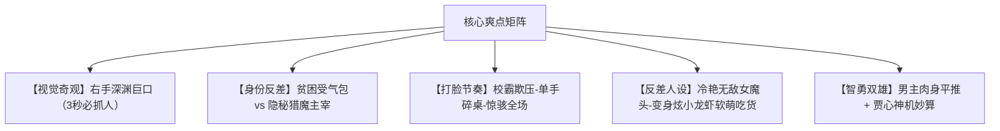

# 竖屏微短剧《掌中有深渊》总案策划与过审指南

---

## 一、 项目商业定位

* **暂定剧名**：《掌中有深渊》（备选：《我的右手能吞异兽》《深渊巡夜使》）
* **题材类型**：都市玄幻 / 悬疑惊悚 / 扮猪吃虎 / 极限打脸 / 异能觉醒
* **播放规格**：竖屏（9:16），共 80~100 集，**单集 40 ~ 50 秒**（抖音/快手/小程序投流黄金规格：高完播、高留存、快切快转）
* **对标作品**：《开局觉醒神级异能》《寄生兽》《毒液》《咒术回战》
* **目标受众**：18-35 岁男性受众为主，兼顾喜爱二次元异能、暗黑爽感、惊悚打怪打脸的年轻网生代群体。

---

## 二、 45秒单集极致工业节奏模型（微短剧核心法则）

在 40-50 秒的极限时长内，必须摒弃传统影视的慢热铺垫，严格执行**“5-15-20-5”**时间轴控制：

* **00 ~ 05秒【黄金前戏·奇观吸睛】**：绝不废话，直接将视觉奇观、生死危机或极致羞辱甩在观众脸上，死守完播率。
* **05 ~ 20秒【冲突拉满·情绪压迫】**：反派极度嚣张、怪物利爪逼近面门，将主角或重要角色逼入绝境，调动观众同情与期待。
* **20 ~ 35秒【反转反杀·爽感释放】**：底牌掀开！肉身异化/掌心裂嘴/一拳爆击，打出超出常理的反击，完成第一波多巴胺释放。
* **35 ~ 45秒【高潮卡点·强留钩子】**：在下一个不可预知的更大危机或动作终结的瞬间戛然而止，促使用户秒点“下一集”或冲动充值。
* **剧本字数红线**：单集剧本字数严格锁死在 **180 ~ 240 字**（台词极简，以镜头动作与音效情绪为主）。

---

## 三、 核心爆款逻辑与多重爽点设计

1. **第一视角的吸睛奇观**：
   * 原生家庭拮据、高三唯唯诺诺的张陈，右手掌心长出一张长满太古獠牙的大嘴，专吃夜幕下的魑魅魍魉。
   * “别人被怪物吓得尿裤子，男主看着怪物咽口水——‘看起来真香’”。
2. **反套路英雄主义（以恶制恶）**：
   * 不讲虚伪的大道理，面对校园霸凌与反派直接物理超度，能动手绝不哔哔。
3. **高粘度情感羁绊**：
   * 对青梅竹马校花王艺芷的绝对偏爱；
   * 收服绝美女怪“富江”后令人捧腹又温馨的反差生活日常。

---

## 四、 审查红线规避与合规化改造（生死攸关）

短剧在抖音、快手、微信小程序及各大视频平台上线，需严格执行广电“网络微短剧备案审查”标准。以下为必须落地的“安全转换表”：

### 1. 名词系统合规替换

| 原始敏感词 | 合规改造名称 | 叙事底层设定解释 |
| :--- | :--- | :--- |
| **鬼物 / 恶鬼** | **异化体 / 执念体 / 暗渊噬生种** | 人类极端负面情绪与地脉游离暗能结合产生的**“生物能量畸变”**。 |
| **狱间 / 地狱** | **苍蓝结界 / 镜渊世界** | 存在于现实维度背面的平行镜像空间，负责调节地球生态平衡。 |
| **狱使** | **巡夜人 / 镇夜司专员** | 官方隐秘编制的超自然调查与安全保障组织，持证上岗。 |
| **主魂石** | **神核 / 暗能共鸣水晶** | 来自高纬度维度的能量载体，赋予人类驾驭特殊场域的能力。 |
| **生吃恶鬼** | **异能噬核 / 能量炼化** | 利用掌心特质直接吸收并纯化畸变能量，非吞食血肉。 |

### 2. 视觉呈现安全法则（严防封禁）

* **禁止血腥肉末**：手掌吞噬过程中，严禁出现撕裂肌肉、内脏、流血喷溅的镜头；
* **采用粒子光效替代**：
  * 掌心裂口开启时，带有**暗紫金色魔焰与符文**（酷炫感为主，类似玄幻机甲）；
  * 怪物被咬中后，迅速化为**蓝黑色的光斑粒子、能量残烟**被卷入掌心；
* **怪物造型非人化**：
  * 原作中的“婴儿鬼”不可使用逼真婴儿尸首形象，应做成**“具有青绿色鳞片的水魅元素生物”**；
  * 强调“怪物”特征（尖耳、触须、魔纹、异瞳），削弱其“死人/尸体”的人形特征。

---

## 五、 商业变现与付费卡点（付费门槛规划）

竖屏短剧通常采用“前 10~15 集免费试看，第 15~20 集首次付费卡点，每 3~5 集一个充值小高潮”的打法：

* **第 1~12 集（留存免费期）**：
  * 密集输出核心奇观（落水换心、掌心生嘴、首吃水怪、反杀校霸），拉高次留率。
* **第 13~15 集（第一大付费卡点）**：
  * **危机悬念**：男主发现校花王艺芷手背浮现诡异红血丝，暗处有一双血红的眼睛盯着她，全校停电，走廊传来尖锐的高跟鞋刮擦声……张陈右手黑焰暴涨：“动她，你死！”（戛然而止，引爆首次充值）。
* **第 35 集（第二大付费卡点 - 官方介入）**：
  * 镇夜司精锐被指甲魔打残，男主黑袍遮面冷酷登场，全场高呼“快逃”，男主却伸手握住巨爪——（付费）。
* **第 55 集（第三大付费卡点 - 富江反差）**：
  * 封印破裂，万年凶煞富江出世，全员绝望，男主一巴掌将其镇压，富江眼中凶光突变，红着脸抱住男主大腿叫“主人”（反差爆笑与刺激，付费解锁后续）。
* **第 75 集（大结局前夜终极付费）**：
  * 三阶 Boss 开启万灵血阵，男主全状态暴食解禁，单手掀翻庄园（燃点冲刺充值）。
