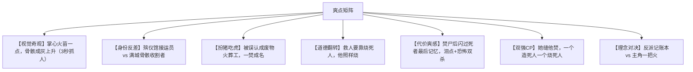

# 竖屏微短剧《末世火葬工》总案策划与过审指南

---

## 一、项目商业定位

| 项 | 内容 |
| :--- | :--- |
| **剧名** | 《末世火葬工》（备选：《我的火只烧死人》《潮名录》《灰潮之下》） |
| **宣传副标** | **我的火，只烧死人。** |
| **题材类型** | 末世异能 / 黑暗爽剧 / 职场冷幽默 / 制度悬疑 / 暗黑养成 |
| **播放规格** | 竖屏（9:16），共 **100 集**，**单集 40 ~ 50 秒**（抖音 / 快手 / 视频号 / 小程序投流黄金规格） |
| **单集字数** | 180 ~ 240 字 |
| **对标作品** | 《我的火球有bug》《我在精神病院学斩神》《末世黑潮》《无限流》《我就是这种sigou》 |
| **目标受众** | 18—35 岁男性为主，兼顾喜欢末世流、暗黑流、反套路爽剧与"职业感"人设的年轻网生代 |
| **改编来源** | 《无尽杀戮：我的火球有bug！》（是也，830 章 / 245 万字）**机制骨架**改编，人物剧情全部原创 |

### 一句话卖点

> **全球每十四天被灰雾洗一遍，活人会被逼成怪物，死人才能停。**
> **一个殡仪馆的火葬工，一团只烧死人的火。**

### 核心反差点（投流钩子的总纲）

| 反差 | 具体 |
| :--- | :--- |
| **职业 × 末日** | 主角不是战士不是学霸，是**遗体接运员**——全片第一个把末世当"夜班"上的人 |
| **天赋 × 缺陷** | 天赋能焚尽万物，**唯独烧不了活人**；而且每烧一具，就多一个人的记忆住在脑子里 |
| **救人 × 消耗** | 他救人靠"烧别人"，救得越多，他越不是自己 |
| **体面 × 荒诞** | 全剧最大的反派从不骂人，他管这叫"归档" |

---

## 二、45 秒单集极致工业节奏模型

严格执行 **"5-15-20-5"** 时间轴：

| 时间段 | 任务 | 本剧具体要求 |
| :--- | :--- | :--- |
| **00~05 秒** | **黄金前戏 · 奇观吸睛** | 绝不放台词铺垫。直接上：手心火苗 / 骨骸成灰 / 灰奴扑脸 / 名录翻页 |
| **05~20 秒** | **冲突拉满 · 情绪压迫** | 敌人极度嚣张或处境极度反常。**每集必须有一个具体的"要命的事"** |
| **20~35 秒** | **反转反杀 · 爽感释放** | 掀底牌。反转必须落在**视觉上**（火起、骨纹亮、律条生效），不靠台词解释 |
| **35~45 秒** | **高潮卡点 · 强留钩子** | 在更大危机即将发生的**动作中途**戛然而止，逼出"下一集" |

### 本剧专属的三条卡点纪律

1. **火的规矩**：每次展示火，必须同时展示代价（手抖 / 瞳孔变色 / 突然说别人的口头禅）。观众看到火，就该想到痛。
2. **陈野的嘴**：全剧前 20 集，陈野的台词总量不超过 **60 字**。他话少，观众才信他有东西。
3. **每 3 集一个小高潮，每 10 集一个大高潮，每 25 集一个卷级爆点**。

---

## 三、核心爽点矩阵

### 三个必须做出来的爆点

1. **第 03 集 · 第一把火**
   全片第一次展示「余烬」。镜头必须给足：手心一点火 → 推向尸体 → 骨骸在橙白窑火里碎成灰粒上升 → 陈野眼睛里闪过死者最后一帧画面（女主与死者同框的闪回 = 观众第一次意识到代价）。**这一集决定留存。**

2. **第 22 集 · 烧师父**
   老沈躺进炉子，背过身去说"记得把我烧干净点"。陈野手心的火第一次**抖**。这一集决定**口碑**。

3. **第 78 集 · 烧弟弟**
   陈远成了半潮主，能听见整座城市的骨骸在响。陈野要烧掉自己的亲弟弟。火点在指尖跳了三跳，灭了一次，又亮起来。**这一集决定付费峰值。**

---

## 四、审查红线规避与合规化改造

短剧需通过广电"网络微短剧备案审查"。以下为必须落地的安全转换表。

### 4.1 名词系统合规替换

| 敏感/高危概念 | 本剧合规形态 | 叙事底层解释 |
| :--- | :--- | :--- |
| 尸体 / 焚尸 | **骨骸 · 归档 · 窑火** | 只表现"灰白骨骸在窑火中碎成灰白颗粒"，全程不见血肉 |
| 丧尸 / 怪物 | **灰奴** | 造型石膏质地、磨砂玻璃球眼、动作僵硬节律；**禁用写实丧尸妆与血浆** |
| 缝合 / 尸检特写 | **修复 · 归档仪轨** | 只拍白大褂、护目镜、工具剪影与背影 |
| 献祭 / 抹除 | **潮罚 · 归档** | 表现为"人在灰雾中被抹去轮廓"，不断肢、不见血 |
| 异能战斗 | **骨纹 · 律条** | 表现为光效与骨纹游走，非超自然恐怖元素 |

### 4.2 视觉呈现安全法则

* **禁止血腥肉末**：焚化过程一律用"橙白窑火 + 冷灰蓝灰粒上升"表现，不出现组织液、骨茬断面特写；
* **灰奴非人化**：皮肤呈石膏质感，眼为磨砂玻璃球，关节动作为"卡顿跳帧"，刻意降低生理恐怖；
* **惊悚靠氛围不靠 gore**：用**音**（窑炉抽风、指甲刮骨、灰粒沙沙）替代血腥画面；
* **死亡一律"转身"**：角色死亡时优先用背对镜头 + 灯灭 + 骨纹熄灭表达。

### 4.3 剧情红线

* 不得出现对现实宗教、民族、政府机构的影射与攻击；
* "收容局"为虚构机构，剧中明确定位为"未公开的非常规处置部门"，不影射任何真实部门；
* 不得出现真实企业、品牌、真实事件引用；
* 不得出现自杀自残的展示性镜头（主角焚己的终局以"窑门关上、火光亮起"处理，不拍人体过程）。

---

## 五、商业变现与付费卡点

* **第 1~12 集（免费留存期）**：密集输出核心奇观——醒来在炉前、第一把火、焚尸继承、救下苏晓棠、收容局初登场、第一个灰奴围杀。目标次留 ≥ 45%。
* **第 13~15 集（第一大付费卡点）**：陈野发现"潮名录"上自己被除名。夜里，殡仪馆停尸间的所有骨骸同时坐了起来。火苗在掌心一跳，熄灭——**他的火今天烧不动活人。**（戛然而止）
* **第 26~28 集（第二大付费卡点 · 进骨窖）**：全城骨骸自动排成队列指向一个下水道井盖。井盖下传来翻骨的声音。阿飞："进去的人，没出来过。"
* **第 50~52 集（第三大付费卡点 · 潮罚者）**：赵岚的上司被抹除，无尸可焚。陈野第一次遇到"烧不掉"的东西。而他身后，那具不存在的东西正在成形。
* **第 75~78 集（终极付费 · 烧弟弟）**：陈远立于骨骸之上，说："哥，你烧的都是死人。"陈野抬手，火在指尖跳了三跳。
* **第 96~100 集（大结局）**：自愿焚己，完成大葬；灰潮散尽；最后一场戏，殡仪馆送来一具新的"遗体"——是陈野自己。留一个第二季钩子。

---

## 六、制作可行性与成本控制

本剧刻意设计成**低场景成本**：

| 场景 | 复用度 | 说明 |
| :--- | :--- | :--- |
| 殡仪馆火化间 | ★★★★★ | 全片主场景，出现 30+ 次。窑门、火化炉、停尸间、后院骨灰塔 |
| 城郊公路 / 废弃厂房 | ★★★★☆ | 灰潮外景与骨窖入口 |
| 收容局办公室 / 仓库 | ★★★☆☆ | 赵岚与骆红线 |
| 白骨原 | ★★☆☆☆ | 仅卷四使用，可用纯特效 + 少量搭景 |

* **演员成本控制**：主要角色 9 人（陈野、苏晓棠、裴烈、纪梵、赵岚、陈远、老沈、阿飞、田坤），另有骆红、无主、灰奴若干（灰奴可用妆造+特效，控制在 3 套造型内）。
* **特效重点**：① 掌心火苗 ② 骨纹继承时"墨水洇开" ③ 灰奴步态 ④ 忆蚀闪回（可用跳切+鱼眼+色差低成本实现）⑤ 双潮叠加的双色雾场。
* **单集成本红线**：控制在 1.5 万元以内，100 集总制作预算约 120—150 万元区间（不含宣发）。

---

## 七、视觉方案：2.5D 虚拟制片规范

### 7.1 结论先行

**本剧应当有明确的 2.5D 质感**，但要做成**虚拟制片（3D 空间 + 2D 角色 + AI 动效）**，绝不能做成"图片平移 + 字幕"的贴纸式动态漫。

这是三条约束叠加后的唯一最优解，不是风格偏好：

1. **预算约束**——单集 1.5 万红线 × 100 集，"每集重做一遍场景"的实拍或纯 AI 长视频生成都撑不住。
2. **场景复用约束**——火化间出现 30+ 次，空间必须一次性建好、全片复用、每次出场完全一致。
3. **竖屏特性**——9:16 景深天然浅，观众视线锁死在中央纵深轴；**分层视差在竖屏里的体积感比横屏强得多**，横移在竖屏里无处安放纵深。

### 7.2 三层架构

| 层 | 承担内容 | 技术路线 | 成本形态 |
| :--- | :--- | :--- | :--- |
| **空间层** | 场景本体 | 火化间 Blender 建模一次（低模 + 贴图 + 体积雾），输出可推拉摇移的多机位素材 | 一次性投入，100 集摊销 |
| **角色层** | 人物表演 | **半写实 3D CG 角色**（风格化面部 + PBR 服装 + 强轮廓光），非真人实拍 | 单集 |
| **动效层** | 奇观特效 | AI 视频（H3 首尾帧）：掌心火苗、骨纹洇开、灰烬、忆蚀碎片 | 单集 |

合成层用 AE / Nuke 完成分层视差与伪 3D 摄影机。**AI 的强项是动效层，不是空间层**——让 AI 去生成"机位推近时的空间透视变化"是浪费算力，让它生成"火焰、骨纹、忆蚀"才是物尽其用。

> ⚠️ **角色层不做真人实拍质感**。这是 2.5D 的核心判据：角色必须是**风格化 CG 造型**——眼睛略放大、下颌柔化、鼻梁简化、皮肤光滑哑光无毛孔、头发块面化、明确的轮廓光。一旦做成照片级写实，空间层与角色层的渲染语言就会打架，画面会塌成"真人抠像贴在 CG 场景上"的廉价合成感。

### 7.3 火化间分层表（美术必背）

| 层 | 内容 | 作用 |
| :--- | :--- | :--- |
| L0 前景 | 窑门、骨灰台 | 出画最快，制造压迫与窥视感 |
| L1 中景 | 人物活动区 | 表演层，视觉重心 |
| L2 后景 | 火化炉本体 | 提供主光源与色温锚点 |
| L3 纵深 | 走廊尽头 + 体积雾 | 提供消失点与空气透视 |

四层独立位移，速率比 **L0 : L1 : L2 : L3 ≈ 3 : 2 : 1 : 0.5**。

### 7.4 伪 3D 摄影机规范

- **推（dolly in）15%–30%** 是主力动作，全剧约七成镜头用推。推近时同步：后景雾浓度 +30%、景深虚化加深、后景降饱和 20%。
- **摇（pan）必须沿纵深轴**——竖屏严禁横向平移，9:16 里横向运动没有纵深可用，只会让画面像贴纸。
- **俯仰 ≤ 5°**，靠透视变化造立体感，而不是靠大幅位移。
- **人物必须带接地阴影 + 环境反射 + 轮廓光**，任缺其一，人物立刻塌成贴纸。

### 7.5 本剧专属红利：忆蚀的多层视差

忆蚀是"死者最后记忆涌入"，天然就是多层视差载体——这是本剧可复制到全片的核心记忆点：

- **近景**：大块失焦记忆碎片（一只手、一张脸、暖色闪回）
- **中景**：半透明叠影在人物身后缓慢漂移
- **远景**：小而锐的碎片在纵深里穿梭

三层以不同速率漂移，配轻微色差与鱼眼畸变。**成本极低，视觉冲击最强。**

### 7.6 骨窖五层 = 五个景深平面

骨窖本身就是五个纵深层（见《05_原创世界观与规则设定》），在 2.5D 下直接对应五个独立图层，摄影机下沉或上浮形成"层间穿梭"的连续运动，成本几乎为零。

### 7.7 红线：不要做成 PPT 剧

行业里大量 AI 短剧死在这里。分界线如下：

| 平移贴纸（NG） | 合格 2.5D（要） |
| :--- | :--- |
| 图层整体平移，人物是贴纸 | 每层独立速率视差 |
| 人物无接地阴影，浮在空中 | 接地阴影 + 环境反射 + 轮廓光齐备 |
| 后景是清晰的平面图 | 后景有雾、光衰减、降饱和 |
| 镜头只有缩放 | 推 + 微摇 + 微俯仰的透视变化 |
| 人物不随景深变化 | 人物随景深有尺度与清晰度变化 |

**验收口径**：把任意一帧的 L0 前景和 L3 纵深分别遮住，剩余画面仍需读得出空间纵深。做不到就是贴纸剧。

### 7.8 与已有资产的衔接

`03_角色设定图/` 下的**定妆肖像 + 三视图**就是 2.5D 角色层的现成输入：以肖像（正脸）/ 三视图（正面 + 四分之三侧 + 背面）作多角度参考喂给 AI 图生视频，可稳定锁住角色一致性，无需每集重新抽卡。

这套角色图本身采用**半写实 3D CG 渲染**（而非真人写实），与空间层的渲染语言一致——它既是角色锁脸的参考源，也是美术、妆造、后期沟通的定妆基准。

---

## 八、复刻边界声明（内部存档）

本项目改编自《无尽杀戮：我的火球有bug！》的**机制骨架**——即"以焚烧尸体为唯一攻击手段，并从死者身上夺取力量"这一抽象设定。

除此之外，**全部内容为原创**：

| 维度 | 源著的处理方式 | 本剧的处理 |
| :--- | :--- | :--- |
| 灾变来源 | 全球性规则降临 | 地球骸骨翻身，灰潮十四日一临 |
| 能力代价 | 无 | **忆蚀**（继承即承受死者最后记忆） |
| 分级体系 | 字母等级制 | 骨纹一至九纹 |
| 规则道具 | 规则卡牌 | 律条（撕下即改写一条区域规则） |
| 副本 | 多重秘境 | 骨窖五层 |
| 榜单 | 双榜并行 | 潮名录（官方版 + 民间版） |
| 终极威胁 | 后期升维玩法 | 双潮交汇 / 潮主 / 潮罚 |
| 终局 | 击杀平行体 | 自愿焚己完成"大葬" |
| 人物 | — | 陈野、苏晓棠、裴烈、纪梵、赵岚… |

> 逐条类别级对照见《05_原创世界观与规则设定》§十一；
> 完整禁词清单与自检命令见内部档案 `00_原著资料/04_禁词与人物黑名单.md`（本地，不公开）。
