# 《末世火葬工》角色设定图

> 全部为**原创角色形象**，AI 生成，仅用于本项目选角、美术、化妆、服装的内部对齐与提案沟通。
> 人物设定来源：`01_短剧策划/02_短剧人物设定档案.md`，与源著无任何形象关联。

## 一、交付规格

每个角色两张图，命名规则与同工作区《注销通知》`手稿/人物图/` 保持一致：

| 类型 | 文件名 | 尺寸 | 用途 |
| :--- | :--- | :--- | :--- |
| **定妆肖像** | `NN_角色名_portrait.png` | 1536 × 2752（9:16 竖版） | 选角参考、封面/海报底图、投流切片首帧 |
| **三视图设定稿** | `NN_角色名_turnaround.png` | 2752 × 1536（16:9 横版） | 服装与妆造细节、背面与侧面确认、后续场景合成基准 |

**三视图统一为纯白无缝影棚背景**，不携带任何环境元素，可直接作为后续场景合成的角色基准；每个视角都是同一个角色、同一张脸、同一套服装。

**渲染质感：高端电影级 3D CG（半写实），不是真人照片。** 这一点与总案《七、视觉方案：2.5D 虚拟制片规范》直接相关——空间层是 CG，角色层也必须是 CG，渲染语言不一致会塌成"真人抠像贴在 CG 场景上"的廉价合成感。

生成链路：`mcode-tools connector call connector__matrix__generate_image`（2K / 原生画幅），三视图以对应肖像作 `input_urls` 锁脸。

重跑脚本（同目录，均可单独执行）：

| 脚本 | 作用 |
| :--- | :--- |
| `gen_turnaround.py` | 批量出三视图，参数为角色编号，如 `python3 gen_turnaround.py 01 03` |
| `gen_regen_leads.py` | 重做主角/女主/弟弟（陈野改「好看的瘦」、苏晓棠口罩下移露全脸、陈远锚定陈野下颌线） |
| `gen_fix_shoes.py` | 补齐女角色三视图的鞋款细节 |
| `gen_regen_style25d.py` | 全员切到 2.5D CG 质感（`all` 跑全部 11 个，也可指定编号） |

---

## 二、角色一览

### 01 陈野 ｜ 男 · 26 · 主角

遗体接运科接运员。**定妆方向：清冷少年感**（已定稿）——脸型偏窄偏鹅蛋、轮廓干净不带攻击性，眼睛大而清澈有神、眼神柔和却专注，眉形清秀舒展不浓重，唇形精致清晰，**下颌线流畅圆润不方**。身高腿长、肩背挺拔，常年深灰工装，手背有洗不掉的石灰白痕，左掌心一小片灰白骨纹透出微弱火光——**全剧唯一不像普通人的地方**，每次使用【余烬】能力都会看见。

> **男主视觉门槛（踩过坑，务必守住）**：
> - 短剧男主要的是「**苏感**」——清冷、干净、有恋爱感。**不是硬汉、不是阴鸷、不是狠人。**
> - ❌ 已否决方向：骨相过分硬朗 + 眼神锐利 → 出图是眉压眼、方腮、唇线紧的**反派狠人脸**，直接掉粉。
> - ✅ 保留的只有「好看的那种瘦」和「疲惫感来自眼神与眼睑」；骨相要**清晰但柔和**，禁方腮、禁浓眉压眼、禁过深法令纹、禁络腮胡黑眼圈。
> - ⚠️ **骨纹必须是长在掌心皮肤上的平面纹路**（像骨头内部的细密骨缝线），不能是悬浮在掌心之上的立体金属符文、也不能是顺着手指延伸的爪状血管纹——这两种都出现过，都很丑。

<figure class="ca-p">
  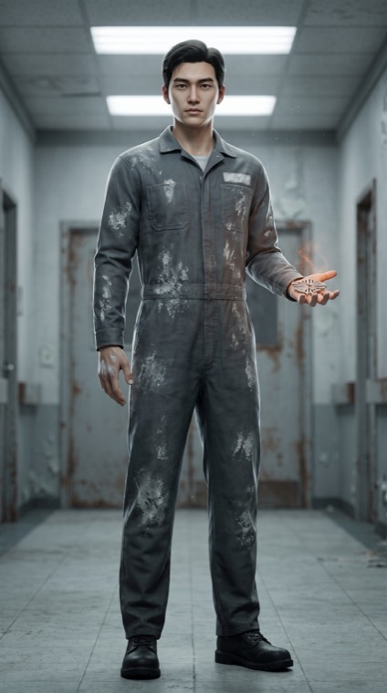
  <figcaption>陈野 · 定妆肖像 9:16</figcaption>
</figure>
<figure class="ca-t">
  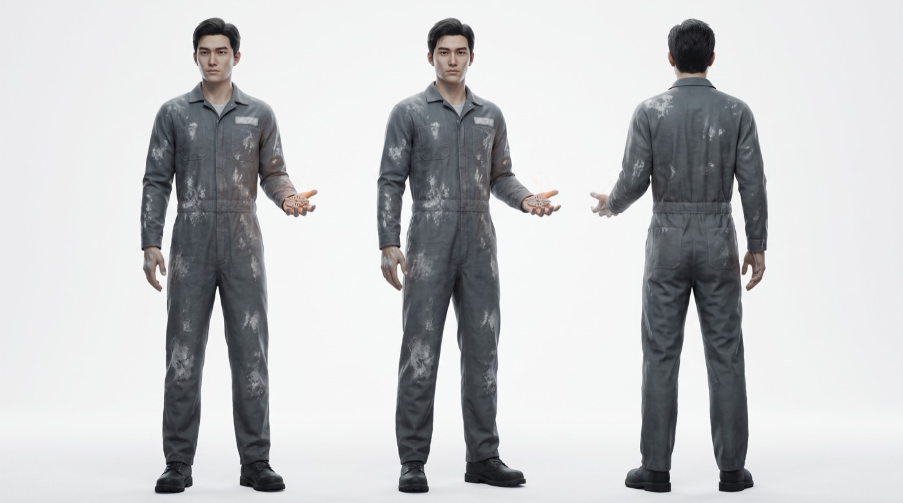
  <figcaption>陈野 · 三视图（正面 / 四分之三侧 / 背面）· 纯白棚拍</figcaption>
</figure>

### 02 苏晓棠 ｜ 女 · 24 · 女主

遗体修复师。**清冷明艳，五官精致、眼睛明亮、眼尾微挑**。白大褂、护目镜推在额上，指尖永远缠着线头，手背布满细密旧疤。全剧唯一不喊的人。

> ⚠️ **定妆图把口罩拉到下巴以下**（工作状态下她仍戴着口罩），因为选角参考必须看得见完整的脸——鼻子、嘴唇、下颌线都不能被挡。拍摄现场按剧情恢复全罩。

<figure class="ca-p">
  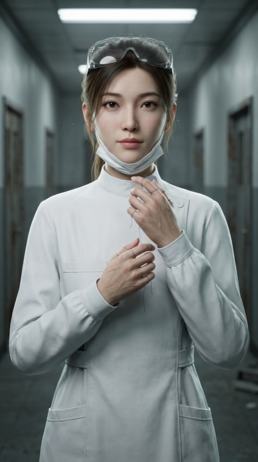
  <figcaption>苏晓棠 · 定妆肖像 9:16</figcaption>
</figure>
<figure class="ca-t">
  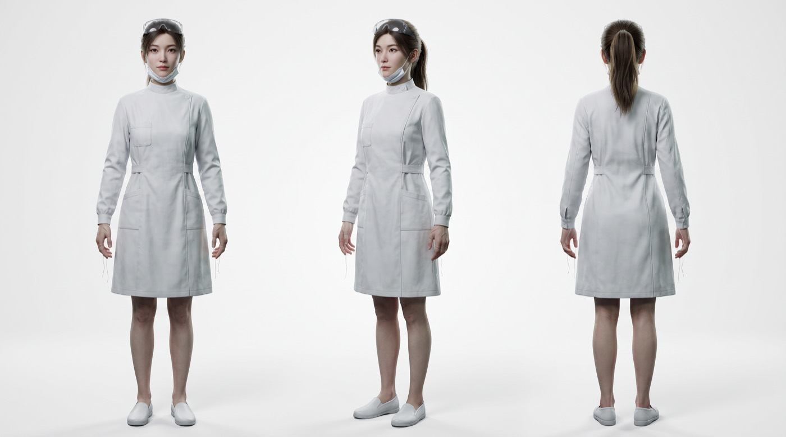
  <figcaption>苏晓棠 · 三视图（正面 / 四分之三侧 / 背面）· 纯白棚拍</figcaption>
</figure>

### 03 裴烈 ｜ 男 · 43 · 大反派

"收骨人"首领。极干净，白大褂无一丝褶皱，指甲修得一丝不苟，说话永远轻声。**干净体面到令人不适**——这是他比陈野更可怕的原因。

<figure class="ca-p">
  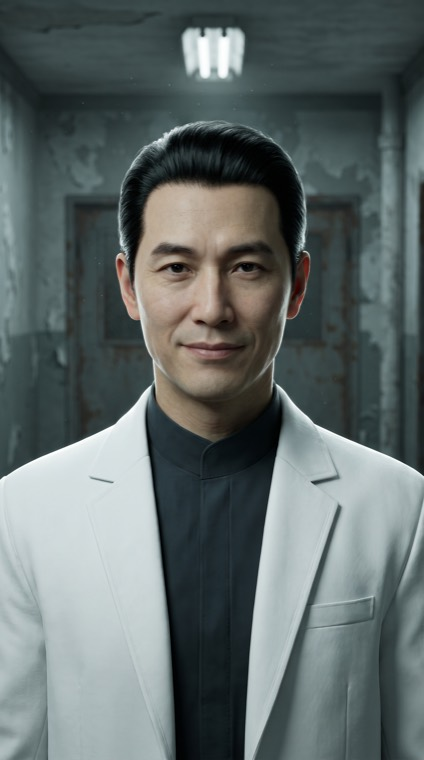
  <figcaption>裴烈 · 定妆肖像 9:16</figcaption>
</figure>
<figure class="ca-t">
  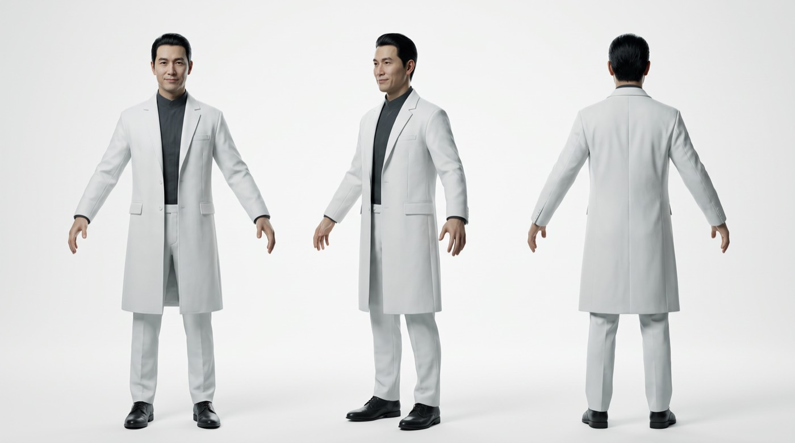
  <figcaption>裴烈 · 三视图（正面 / 四分之三侧 / 背面）· 纯白棚拍</figcaption>
</figure>

### 04 纪梵 ｜ 男 · 27 · 副手

裴烈副手，【易容】天赋。真正的纪梵在第一场灰潮就死了，现在这张脸是他哥哥的。**他的脸必须"像又不像"本人**。

<figure class="ca-p">
  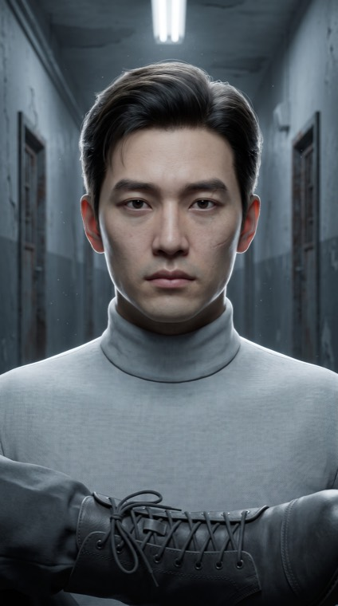
  <figcaption>纪梵 · 定妆肖像 9:16</figcaption>
</figure>
<figure class="ca-t">
  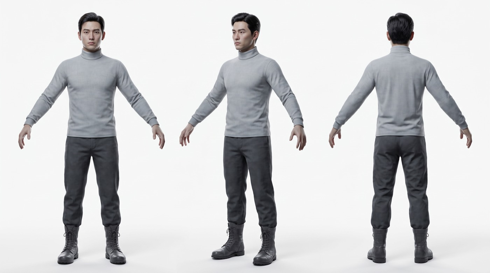
  <figcaption>纪梵 · 三视图（正面 / 四分之三侧 / 背面）· 纯白棚拍</figcaption>
</figure>

### 05 陈远 ｜ 男 · 19 · 弟弟

建筑系大一学生，第 10 集被带走，第 60 集以"半潮主"归来。与陈野相似的下颌线，是血缘的视觉锚点。

<figure class="ca-p">
  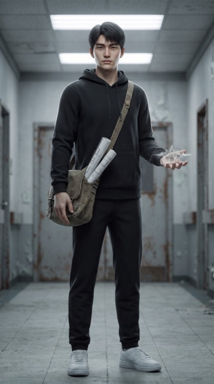
  <figcaption>陈远 · 定妆肖像 9:16</figcaption>
</figure>
<figure class="ca-t">
  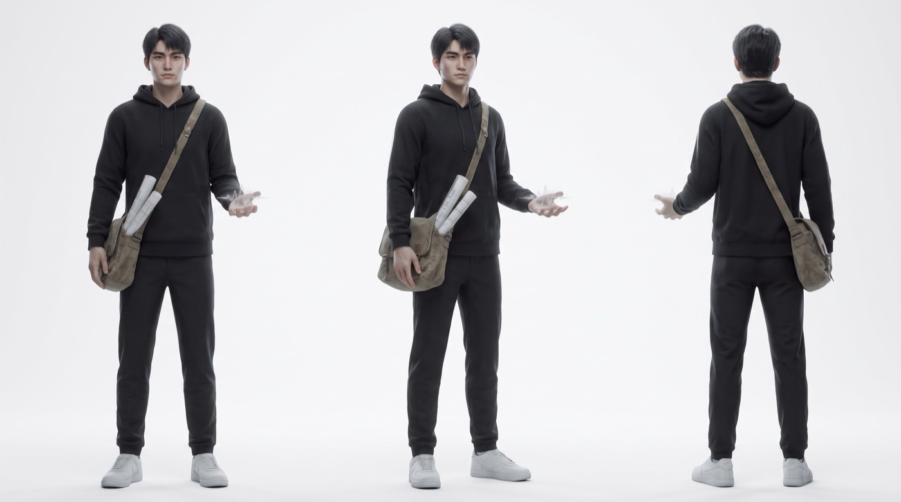
  <figcaption>陈远 · 三视图（正面 / 四分之三侧 / 背面）· 纯白棚拍</figcaption>
</figure>

### 06 赵岚 ｜ 女 · 32 · 官方制衡

收容局现场处置三队队长。战术制服、利落短发、眼神有压迫感。**不能拍成冷血官僚**，她是体制里那个还想把事情做对的人。

<figure class="ca-p">
  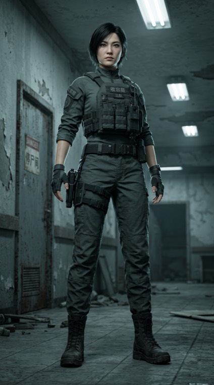
  <figcaption>赵岚 · 定妆肖像 9:16</figcaption>
</figure>
<figure class="ca-t">
  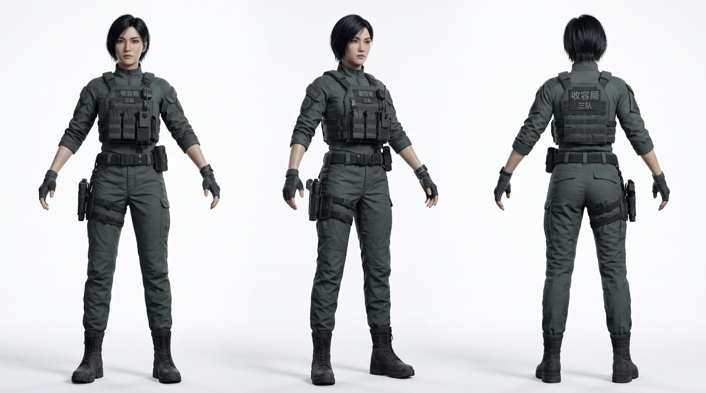
  <figcaption>赵岚 · 三视图（正面 / 四分之三侧 / 背面）· 纯白棚拍</figcaption>
</figure>

### 07 骆红 ｜ 女 · 46 · 体制复杂度

收容局局长。不是恶人，只是每次都选了代价更小的那条路。

<figure class="ca-p">
  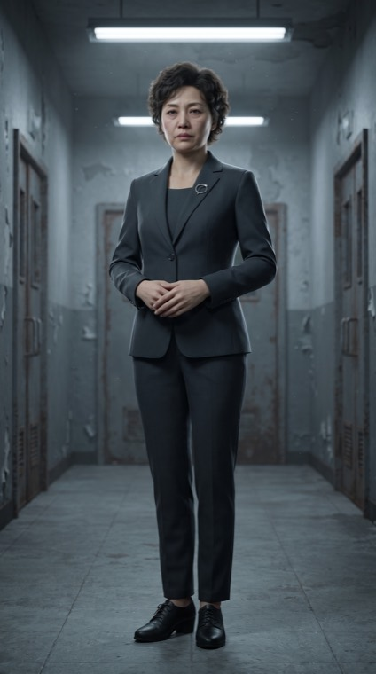
  <figcaption>骆红 · 定妆肖像 9:16</figcaption>
</figure>
<figure class="ca-t">
  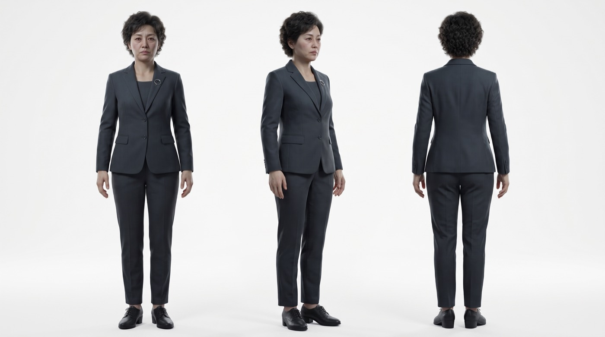
  <figcaption>骆红 · 三视图（正面 / 四分之三侧 / 背面）· 纯白棚拍</figcaption>
</figure>

### 08 老沈 ｜ 男 · 64 · 师父

火葬馆老馆长。旧藏青色中山装洗得发白，手掌布满老茧与烫伤旧疤。**第 22 集他被陈野亲手归档**，这张图是那一集的定妆基准。

<figure class="ca-p">
  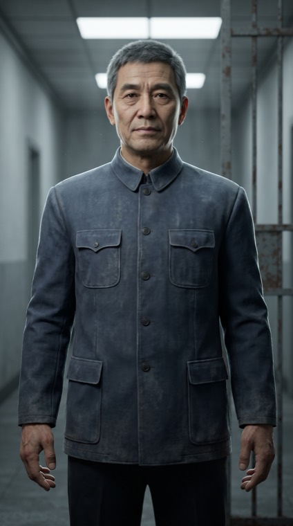
  <figcaption>老沈 · 定妆肖像 9:16</figcaption>
</figure>
<figure class="ca-t">
  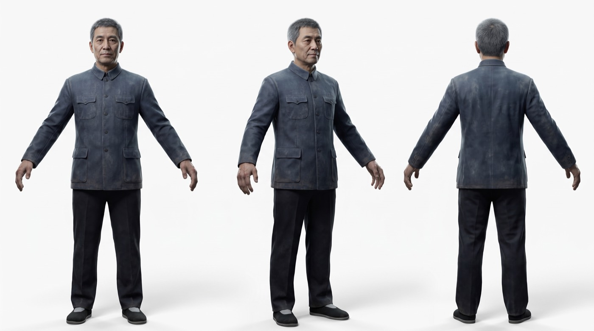
  <figcaption>老沈 · 三视图（正面 / 四分之三侧 / 背面）· 纯白棚拍</figcaption>
</figure>

### 09 阿飞 ｜ 男 · 21 · 情报与笑点

黑市掮客。【回声】天赋能听见死者留在物品上的最后一句话。痞气、灵活、有点紧张不安。

<figure class="ca-p">
  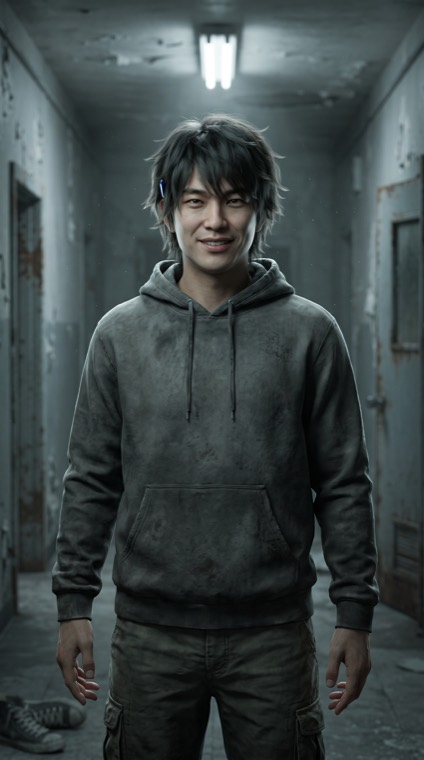
  <figcaption>阿飞 · 定妆肖像 9:16</figcaption>
</figure>
<figure class="ca-t">
  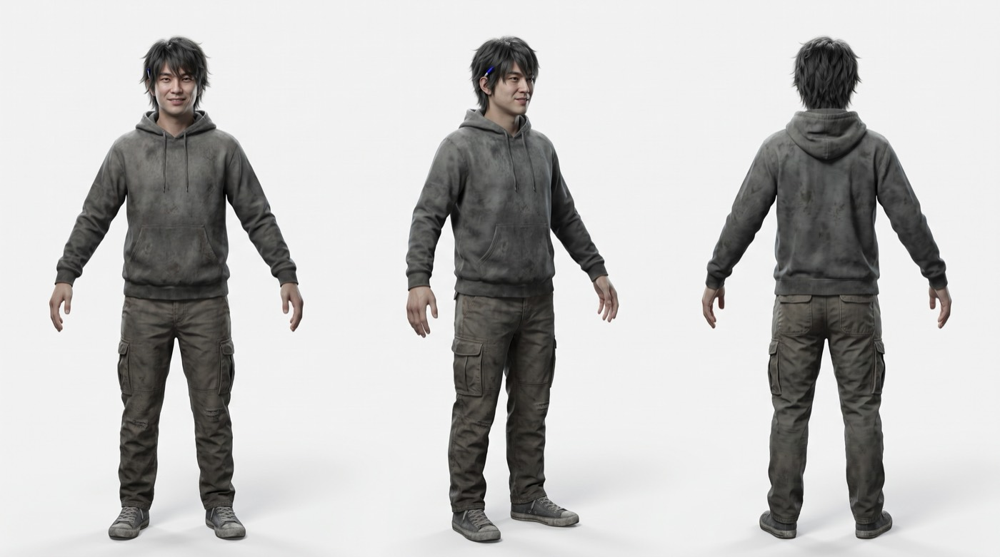
  <figcaption>阿飞 · 三视图（正面 / 四分之三侧 / 背面）· 纯白棚拍</figcaption>
</figure>

### 10 田坤 ｜ 男 · 34 · 肉盾

货运司机，前刑满释放。憨厚、义气、能扛。**第 74 集他挡在陈远前面被拆成骨件**。

<figure class="ca-p">
  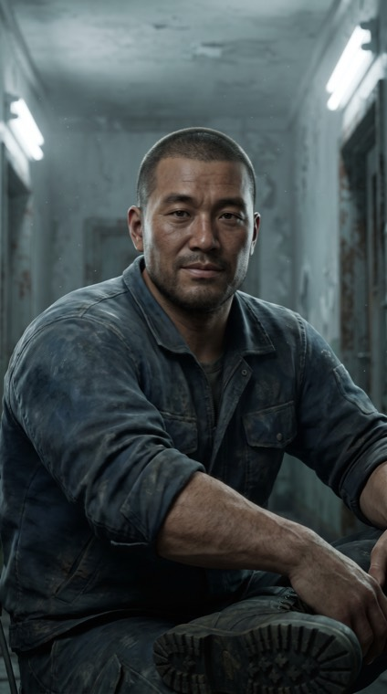
  <figcaption>田坤 · 定妆肖像 9:16</figcaption>
</figure>
<figure class="ca-t">
  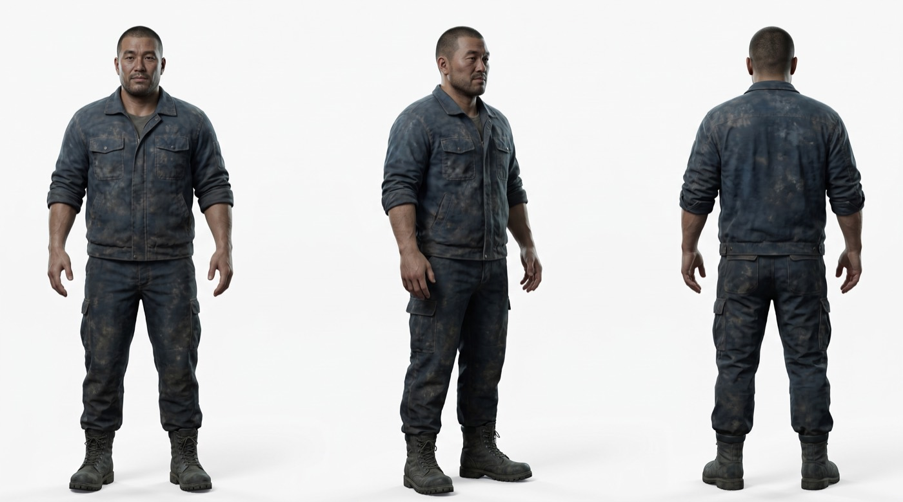
  <figcaption>田坤 · 三视图（正面 / 四分之三侧 / 背面）· 纯白棚拍</figcaption>
</figure>

### 11 「无主」 ｜ 白骨原 · 意识碎片

不是人，是地球这具骸骨残留的意识碎片。定妆稿把它演绎为**骨白色的人形骨骸**：没有皮肤与血肉，胸腔是通透的肋骨骨架，**胸腔空洞处透出微弱暖橙火光**，周身漂浮灰烬与骨屑。**没有恶意，它只是很孤独**。

> 视觉口径：**骷髅化是有意的**——比抽象人形更能让观众一眼读出"这具身体是地球的"。后续所有素材（关键帧、切片、海报）沿用同一套骨骸形态，不要再画回无五官的抽象轮廓。

<figure class="ca-p">
  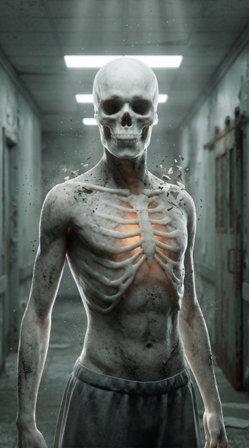
  <figcaption>「无主」 · 定妆肖像 9:16</figcaption>
</figure>
<figure class="ca-t">
  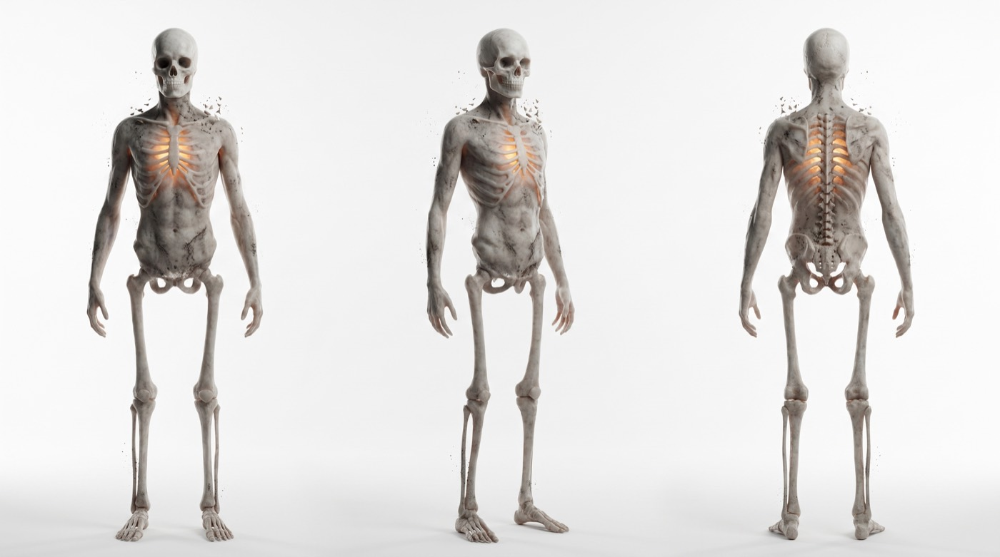
  <figcaption>「无主」 · 三视图（正面 / 四分之三侧 / 背面）· 纯白棚拍</figcaption>
</figure>

---

## 三、视觉统一规范

- **渲染语言**：高端电影级 3D CG（Unreal 级别），**不是真人照片**。判断标准——皮肤有次表面散射的柔光、头发有丝缕结构与自然高光、布料是 PBR 有真实褶皱与厚度、有明确的亮色轮廓光。
- **面部**：五官比例写实清晰，眼神有神。**不要过度卡通化**（大眼、圆脸、简化鼻梁）——那是低模手办，不是 2.5D 短剧；也不要照片级写实（毛孔、真实皮肤噪点），那会和 CG 空间层打架。
- **色调**：冷灰青，低饱和。全剧不做高饱和奇幻色，情绪靠光比和材质走。
- **光**：柔和顶光加侧逆光，空气里有可见灰尘颗粒与体积光。恐怖来自"干净的不干净"——裴烈最干净，所以最毛骨悚然。
- **环境**：废弃殡仪馆走廊、锈蚀铁门、剥落的墙皮。**不做现代都市感**，不做末世废土的过度符号化（不出现骷髅堆、血浆、破败军装）。
- **禁止**：低多边形低模、PS1 复古画质、塑料手办感、二维平面动画、赛博朋克霓虹、游戏 HUD 界面、过度磨皮、任何文字水印。

## 四、人物一致性红线

1. **陈野 ≠ 冷血 ≠ 狠人**。他是清冷系帅哥，不是阴鸷反派。骨相清晰但柔和，疲惫感只走眼神与眼睑。**眉压眼、方腮、浓眉、络腮胡、黑眼圈一律不要。**
2. **骨纹只长在掌心**。是平面的、收在掌心中央的皮肤纹路。不悬浮、不延伸到手指、不画成爪状或血管状。
3. **苏晓棠不是工具人**。她的温柔是执念的外壳，不是柔弱。
4. **裴烈不许降智**。他的可怕来自"体面"与"高效"，不是来自凶相。
5. **纪梵的脸要有"违和感"**。太正常就废了。
6. **忆蚀必须可视**。第 30 集后陈野每次用能力都要能看见代价：手抖、瞳孔变色、口音变化。角色图是这条线的起点。
7. **陈远必须和陈野像**。兄弟的下颌线、眉形、眼睛形状一致，陈远只是更年轻更清瘦。定妆图已锁定血缘脸。

## 五、版权边界

本组角色图为原创生成，**与源著《无尽杀戮：我的火球有bug！》无形象、姓名、造型关联**，可随站点公开。
源著的设定百科、剧情梗概、禁词黑名单与原文仍仅存本地，不随站点公开。
