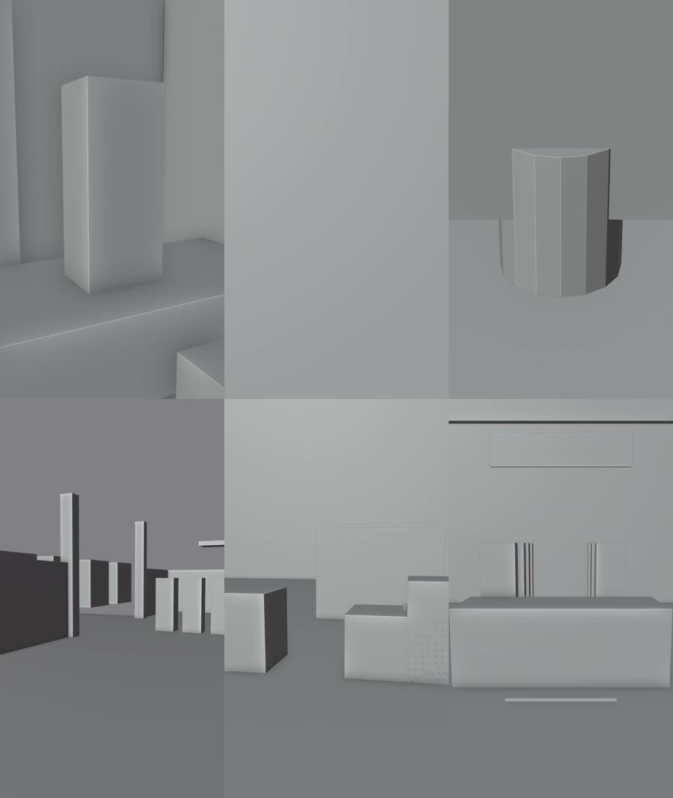
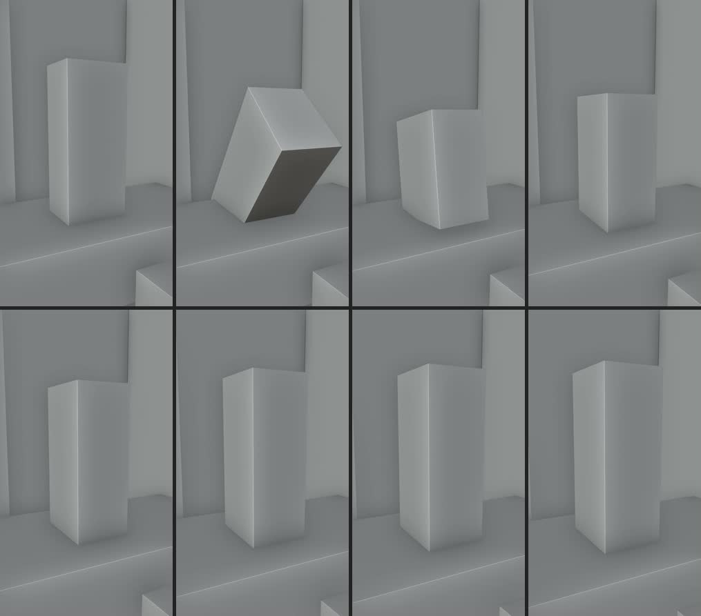

# 白模质量诊断 · 修复前证据板

> 诊断时间：2026-10-23 · 触发：用户反馈「我觉得白模型的质量太差了」
> 结论：**不是渲染/美术问题。白模在几何与构图上没有表达出 D11 的画面事实。**
> 权威真值：`units/<UNIT>/D14_shots/<shot>/projection.json`（投影）＋ `source_anchor_frames/anchor_*.jpg`（实拍帧）

---

## 图 1 · 6 镜代表帧（修复前）

| 位置 | 镜头 | D11 声明 | 实拍画面 | 缺陷 |
|---|---|---|---|---|
| 左上 | U01/ep01_shot01 | 中景 35mm「陆沉手掌撑住床沿坐起」 | 空房间 + 一根**竖白板** | 角色代理体被立起来（见图 2）；场景空 |
| 中上 | U01/ep01_shot02 | **特写** | **整帧纯灰渐变** | 画幅内**无任何角色**；最大对象是 EXT 走廊（100%） |
| 右上 | U01/ep03_shot03 | 近景「右腕骨纹 POV」 | 一个八棱柱 | 主体不可读；实拍可见前景遮挡 |
| 左下 | U01/ep05_shot01 | 中远景 | 一排黑白竖板 | 画幅内**无角色**；最大对象是 EXT 管道架 |
| 中下 | U02/ep11_shot02 | 中景 | 几个白盒子 | 画幅内**无角色**；最大对象是 EXT 厂房外壳 |
| 右下 | U02/ep13_shot02 | 近景 | 一张白柜台 | 画幅内**无角色**；最大对象是 LGT 灯箱 |

## 图 2 · U01/ep01_shot01 的 7 帧全过程（修复前）

第 1 帧是**竖立的白色板子**；**第 2 帧它斜着翻滚约 45°**；第 3–7 帧回到竖直白板立在空房间里。
⇒ 这不是「美术粗糙」，是**姿态数据与几何实现错误**：躺着的人被建成了竖板，且旋转关键帧插值造出了翻滚。

---

## 全量量化（64 镜）

| 指标 | 实测 | 判定 |
|---|---|---|
| 角色代理体**完全不在画幅内** | **24 / 64（37.5%）**（U01 9、U02 15） | ❌ |
| 画面最大对象是**角色** | **10 / 64（15.6%）** | ❌ |
| 最大对象是 EXT 外壳 / PROP 道具 / LGT 面板 | 33 / 14 / 7 | ❌ 主体让位给环境 |
| 角色可见的 40 镜，占画幅高 | 中位 58.8%，区间 8.2%–100% | ⚠️ 离散过大 |

### 景别映射错位（角色可见镜，按 D11 `shot_size` 分组）

| D11 景别 | n | 实测占幅中位 | 目标区间 | 判定 |
|---|---|---|---|---|
| 特写 | 4 | 42.4% | 70–95% | ❌ 特写不够特 |
| 近景 | 8 | 63.0% | 55–85% | ⚠️ |
| 中景 | 19 | 63.6%（上限 100%） | 35–65% | ❌ 有镜角色占满画幅 |
| 中远景 | 5 | 47.9% | 20–40% | ⚠️ |
| 远景 | 3 | 17.8% | 8–25% | ✅ |
| 全景 | 1 | 90.3% | 5–20% | ❌ 完全反了 |

---

## 四条根因（附代码坐标）

| # | 根因 | 坐标 | 后果 |
|---|---|---|---|
| **R1** | 角色代理体是**单一长方体**（无头、无躯干四肢区分、无朝向） | `build_white_model.py:350` / `:419` | H3 拿到的合同里「人」是一根柱子 ⇒ 84% 的镜主体不是人 |
| **R2** | `lie` 尺寸已按「长轴沿 X」给，却又叠加 `rotation_euler=(0,-90°,0)` 把长轴立成竖直；`animate_char` 再插 rotation 关键帧 | `white_model_content_U01.py:597` + `build_white_model.py:421-422` / `:587-600` | 躺着的人变竖板（实拍第 1/3–7 帧）＋ 45° 翻滚（第 2 帧） |
| **R3** | `POSE_SIZE` **缺 `run`**；`CHAR_ANIM` 静默覆盖 `CHARS`，4 处姿态冲突永不暴露 | `white_model_content_U01.py:590-598`；`build_white_model.py:408-412` | (A-1,1) lie vs seated、(A-1,4) stand vs **run**、(A-7,22) stand vs kneel、(A-8,28) kneel vs stand |
| **R4** | 外壳填满画幅、相机贴墙；`clear_keys_from_camera` 只处理「机位落在角色体内」，**没有「角色是否在画幅内」的兜底** | `build_white_model.py:313-334` / `:400-405` | 24 镜画幅内没人；84% 镜主体让位给环境 |

## 流程层的根因（更严重的一层）

**工厂此前没有任何一条规则把 D11 的 `shot_size` 与白模投影占幅绑定。**
所以这 64 镜的几何失真**一路校验全绿**——失真产物在产线上畅通无阻。

已补两道闸：

| 闸 | 位置 | 判什么 |
|---|---|---|
| **V12 白模构图一致性** | `04_工具/lib/rules.mjs`（V1–V12） | 输出层：D11 景别 ↔ 投影实测占幅（W1 角色在画幅／W2 占幅∈区间／W3 最大对象是角色／W4 无姿态翻滚／W5 姿态词表） |
| **W6 白模姿态数据一致性** | `04_工具/check_white_model_poses.py` | 输入层：CHAR_ANIM↔CHARS 冲突、POSE_SIZE 覆盖、词表合法、`lie` 旋转残留 |

阈值真源：`03_规格/rules.json` → `white_model_framing`。
负测：`04_工具/test_white_model_framing.mjs`（10 腿全过，含 3 条反证腿）。

**V12 挂载后的真盘实测**：U01 报 30 error（32 镜里只有 2 镜构图正确）、U02 报 32 error、U03 无白模正确 PASS。

---

## 修复状态

| 项 | 状态 |
|---|---|
| 诊断与取证 | ✅ 完成 |
| 施工图（事实基线＋根因＋改造要求 C1–C5＋验收判据 W1–W8） | ✅ `02_项目/双相潮主/scripts/_白模重建施工图_U01U02.md`（已修订至 v4） |
| V12 / W6 两道闸 + 阈值参数 + 负测 | ✅ 已落地并接进 `validate.mjs` |
| 章程收口 | ✅ `00_团队章程.md` §六·二 + 变更 v2.6 |
| 白模重建（U01/U02 64 镜） | ⏳ 白模场景师执行中（Q94，走 Q87 A 路径，不重落锁） |
| 修复后对照图 | ⏳ 待重建完成后由总控复核并补入本目录 |
